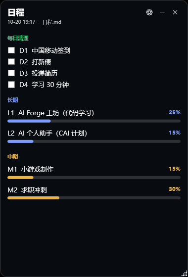

# 日程挂件 · DeskWidget

[](https://github.com/jintying/desk-widget/actions/workflows/build.yml)
[](https://github.com/jintying/desk-widget/releases)
[](LICENSE)

一个轻量的 Windows 桌面日程挂件：把 Markdown 待办清单固定在桌面，**直接读你的文档，勾选直接写回文档**。

- 🪶 **零依赖**：单文件 exe（约 43 KB），只需系统自带的 .NET Framework 4.x，不装 Node/Electron
- 📄 **文档即数据**：数据就是一份 `.md`，用任何编辑器都能改，改完挂件 1 秒内自动刷新
- ✅ **双向同步**：挂件里勾选 → 文档里的 ⬜ 变成 ✅；你在文档里改 → 挂件自动更新
- 🎛 **设置页**：背景色、透明度、字号、位置、开机自启、导入文件，都在图形界面里调
- 🗂 **托盘常驻**：收进右下角通知区（和微信/QQ 一样），右键可设置或退出
- 🖱 **自由拖动**：拖标题栏移动，拖右下角缩放
- 🪟 **不挡工作**：默认不置顶，任何窗口都会盖住它，只在桌面层显示

---

## 快速开始

> ⚠️ **源码仓库里没有 `DeskWidget.exe`**。
> `.gitignore` 排除了 `*.exe`，成品只放在 Release 里（由 GitHub Actions 编译产出）。
> 所以**不要在这个页面的文件列表里找 exe**，按下面两种方式之一获取。

### 方式 A：下载现成程序（推荐）

1. 打开 **[最新 Release](https://github.com/jintying/desk-widget/releases/latest)**
2. 在 **Assets** 里下载 `DeskWidget.exe`（约 150 KB）
   - 或下载 `DeskWidget-x.y.z.zip`（含 exe、README、示例文档）
3. 放到任意目录（例如 `D:\Tools\DeskWidget\`），**双击运行**
4. 首次启动会在 exe 同目录生成 `widget-config.json`

> 若弹出「Windows 已保护你的电脑」或「无法验证发布者」：点「更多信息 → 仍要运行」。
> 原因：个人项目没有购买代码签名证书，这是 Windows 对未签名程序的常规提示。

### 方式 B：从源码构建

需要 Windows 10/11 + .NET Framework 4.x（系统自带，无需额外安装 SDK）。

```powershell
git clone https://github.com/jintying/desk-widget.git
cd desk-widget
powershell -ExecutionPolicy Bypass -File build.ps1
```

构建产物 `DeskWidget.exe` 会出现在仓库根目录。

### 准备日程文档

点挂件右上角 **⚙ → 数据源 → 浏览…** 选中你的 `.md` 文件，或者直接编辑 `widget-config.json` 里的 `dataPath`。

文档格式见下方 [日程文档格式](#日程文档格式)。也可以点设置页的 **「生成示例文档…」** 得到一份模板，或直接用 [`example/日程示例.md`](example/日程示例.md)。

---

## 日程文档格式

挂件识别三类结构。**格式不对不会报错，只是那部分不显示**——设置页会告诉你识别到了多少条。

### 每日任务（可勾选，会写回文档）

必须放在 `## 三、` 开头的小节里，用表格，第三列是 `⬜` 或 `✅`：

```markdown
## 三、🟩 每日任务

| 编号 | 任务 | 今日 | 备注 | 用时 |
| :--- | :--- | :---: | :--- | :--- |
| **D1** | 中国移动签到 | ⬜ | 掌上生活 App | 1 分钟 |
| **D2** | 打新债 | ⬜ | 交易日 9:30–15:00 | 2 分钟 |
```

> 编号必须是 `D` + 数字（D1、D2…）。
> **勾选挂件里的复选框 = 把这一行的 ⬜ 改成 ✅，直接写进这个 md 文件。**

### 长期任务

用三级标题，格式 `### L数字 · 任务名`，小节内出现「进度」的行里写百分比：

```markdown
### L1 · 代码学习

| 字段 | 内容 |
| :--- | :--- |
| **进度** | **25%** |
| **状态** | 🟡 进行中 |
```

### 中期任务

同上，编号用 `M`：

```markdown
### M1 · 小游戏制作

| 字段 | 内容 |
| :--- | :--- |
| **进度** | **15%** |
```

### 分组颜色

| 前缀 | 分组 | 颜色 |
| :--- | :--- | :--- |
| `D` | 每日清理 | 🟢 绿 |
| `L` | 长期 | 🔵 蓝 |
| `M` | 中期 | 🟡 黄 |

### 完整示例

见 [`example/日程示例.md`](example/日程示例.md)。

---

## 界面

```
┌──────────────────────────────┐
│ 日程                    ⚙ ─ ✕ │  ← 拖这条移动窗口
│ 10-20 14:17 · 日程.md          │
│                              │
│ 每日清理                      │
│ ☐ D1  中国移动签到             │  ← 点击勾选，写回 md
│ ☐ D2  打新债                  │
│                              │
│ 长期                          │
│ L1  AI Forge 工坊        25%  │
│ ██████░░░░░░░░░░░░░░          │  ← 进度条
│                              │
│ 中期                          │
│ M1  小游戏制作           15%  │
│ ███░░░░░░░░░░░░░░░░░          │
│                              │
└──────────────────────────────┘
                              ↘ 拖右下角缩放
```

| 操作 | 效果 |
| :--- | :--- |
| 拖标题栏 | 移动窗口 |
| 拖右下角 | 调整大小 |
| 点复选框 | 勾选/取消，**写回 md** |
| 点 ⚙ | 打开设置 |
| 点 ─ 或 ✕ | 收起到托盘（不退出） |
| 托盘双击 | 显示/隐藏 |
| 托盘右键 | 显示挂件 / 设置 / **退出** |

---

## 设置项

| 项 | 说明 |
| :--- | :--- |
| 背景不透明度 | 0.30（很透）~ 1.00（不透明），默认 0.82 |
| 字号 | 10 ~ 20 |
| 背景色 | HEX，如 `#121A26`；也有 6 个预设色块 |
| 强调色 | 进度条与分组标题的颜色 |
| 开机自动启动 | 勾选后写入注册表 `HKCU\...\Run`，无需管理员 |
| 启动后直接收进托盘 | 开机时不弹窗 |
| 数据源 | 日程 md 的完整路径，可浏览选择 |
| 快速配色 | 6 个预设色块，含 #F2F7FC（浅蓝白）等 |

设置改动会立即预览，点「保存」写入 `widget-config.json` 并立即生效。

---

## 配置文件

`widget-config.json`（与 exe 同目录）：

| 字段 | 默认 | 说明 |
| :--- | :--- | :--- |
| `dataPath` | `日程.md` | 日程文档路径（相对路径以 exe 目录为基准） |
| `width` / `height` | 380 / 560 | 窗口尺寸 |
| `left` / `top` | -1 / 120 | 位置；`left = -1` 表示自动贴屏幕右侧 |
| `bgAlpha` | 0.82 | 背景不透明度 |
| `fontSize` | 13 | 正文字号 |
| `bgColor` | `#121A26` | 背景色 |
| `accent` | `#7C9CFF` | 强调色 |
| `fontFamily` | `Microsoft YaHei` | 字体 |
| `autoStart` | false | 开机自启（与注册表保持同步） |
| `startMinimized` | false | 启动即收进托盘 |

参考 [`widget-config.example.json`](widget-config.example.json)。

---

## 常见问题

**Q：我的勾选会同步到文档里吗？**
会。勾选复选框时，程序会把该行第三列的 `⬜` 改写为 `✅`（取消则改回），并直接保存到 md 文件。文件修改时间会变，用 Git 之类的工具能看到 diff。

**Q：我在编辑器里改了文档，挂件会更新吗？**
会。每秒检查一次文件修改时间，变了就重新渲染。

**Q：为什么看不见挂件？**
它**不会置顶**——任何窗口都会盖住它。按 `Win+D` 回到桌面，或点任务栏最右边的「显示桌面」就能看到。这是刻意设计，避免挡住你的工作。

**Q：点 ✕ 后窗口不见了，怎么恢复？**

分两种情况：

**情况 A：托盘图标正常** —— 窗口收进通知区域，双击托盘图标恢复。Win11 若看不到图标，点任务栏 `^` 查找。

**情况 B：托盘图标创建失败** —— 程序会自动把窗口**折叠成一个小胶囊**（52×52 的蓝色圆角方块，带日历图标），停在原位置附近。**点一下胶囊即可展开**。

> 有些机器上安全软件会拦截 `Shell_NotifyIcon`，导致托盘图标无法创建（错误码 5 = 拒绝访问）。
> 这种情况下胶囊模式是兜底方案，功能完全等价，只是入口位置不同。

**Q：托盘图标创建失败怎么办？**

点 ✕ / ─ 只是把窗口**收进通知区域**（不是退出）。

Windows 11 默认会把新的托盘图标塞进**折叠区**，所以图标可能藏在任务栏右边的 **`^`** 小箭头里：

1. 点任务栏右下角的 **`^`**（在时间/输入法左边），展开折叠区
2. 找到挂件的图标（深色方块 + 三色进度条），**双击**即可重新显示窗口
3. 想让它常驻：用鼠标把图标从折叠区**拖到任务栏上**

另外，**再次双击 `DeskWidget.exe` 也会唤回正在运行的窗口**（程序有单实例保护，不会开出第二个）。

**Q：怎么真正退出？**
右键托盘图标 → **退出**。

**Q：这一栏叫什么？**
叫**通知区域（Notification Area）**，也叫**系统托盘（System Tray）**。微信、QQ 最小化后缩到的就是这个位置。

**Q：开机自启没生效？**
检查注册表 `HKEY_CURRENT_USER\Software\Microsoft\Windows\CurrentVersion\Run` 里有没有 `DeskWidget` 项；若 exe 移动了位置，需要重新勾选一次。

**Q：支持多显示器吗？**
支持。把窗口拖到目标显示器上，位置会记住。

**Q：需要管理员权限吗？**
不需要。开机自启写的是当前用户注册表。

---

## 项目结构

```
desktop-widget/
├── src/
│   ├── Program.cs          入口：单实例、托盘、全局异常兜底
│   ├── WidgetWindow.cs     主挂件窗口：渲染、拖动、缩放
│   ├── SettingsWindow.cs   设置页
│   ├── AppConfig.cs        配置读写
│   ├── Schedule.cs         Markdown 解析与回写
│   └── Shell.cs            托盘图标与开机自启
├── example/
│   └── 日程示例.md          可直接使用的模板
├── app.ico                 图标
├── build.ps1               一键构建
├── widget-config.example.json
├── DeskWidget.exe          构建产物（不进仓库，见 Release）
├── LICENSE                 MIT
└── README.md
```

---

## 技术说明

- **UI**：WPF（`AllowsTransparency` + 圆角 Border 实现半透明玻璃观感）
- **托盘**：`System.Windows.Forms.NotifyIcon` + `ContextMenuStrip`
- **自启**：`HKCU\Software\Microsoft\Windows\CurrentVersion\Run`
- **构建**：`csc.exe`（.NET Framework 4.x 自带，无需安装 SDK）
- **为什么不用 Electron**：这个工具的职责很窄，Electron 会带来 100 MB+ 的运行时；WPF 版整包 43 KB
- **为什么不置顶**：需求是"不遮挡工作"。置顶 + 鼠标穿透做不到"看得见又能点"，所以选择桌面层方案，配合托盘和 `Win+D`

## 已知限制

- 只解析"每日任务 / 长期 / 中期"三类结构，其他 Markdown 内容不会显示
- 进度条只能通过改文档里的百分比更新，挂件里不能拖拽调整
- 半透明是 WPF 自绘，不是 Windows 11 的云母/亚克力材质

## 路线图

- [ ] 拖拽调整进度
- [ ] 长期任务折叠/展开
- [ ] 多主题预设
- [ ] 导出为图片分享

## 许可证

[MIT](LICENSE)


---

## 图标

当前图标由 `tools/make-icon.ps1` 用代码绘制：

- 蓝色渐变圆角底（`#4F9CF7` → `#2563EB`）
- 白色日历图形，取自系统字体 **Segoe Fluent Icons**（Win11）/ **Segoe MDL2 Assets**（Win10）
- 输出 16 / 24 / 32 / 48 / 64 / 128 六个尺寸，使用 BMP 帧（GDI+ 兼容性最好）

### 更换图标

改 `tools/make-icon.ps1` 里的字形编码即可（Segoe Fluent Icons 码位）：

| 码位 | 图形 |
| :--- | :--- |
| `E787` | 日历（当前） |
| `E8FD` | 清单 |
| `EA3B` | 任务列表 |
| `E9D5` | 清单勾选 |
| `E73A` | 收藏星标 |

```powershell
# 例如换成"清单勾选"
pwsh -File tools/make-icon.ps1 -Glyph '&#xE9D5;'
pwsh -File build.ps1
```

也可以用现成的图标库替换 `app.ico`（保持文件名不变，重新 `build.ps1` 即可）。

### 推荐图标资源

| 资源 | 授权 | 说明 |
| :--- | :--- | :--- |
| [Tabler Icons](https://tabler.io/icons) | MIT | 6000+ 线性图标，风格统一，适合工具类 |
| [Remix Icon](https://remixicon.com) | Apache-2.0 | 3000+ 图标，线性+填充两套 |
| [Lucide](https://lucide.dev) | ISC | Feather 的继任者，极简线性 |
| [Material Symbols](https://fonts.google.com/icons) | Apache-2.0 | Google 官方，种类最全 |
| [Simple Icons](https://simpleicons.org) | CC0 | 品牌图标 |
| [Iconify](https://icon-sets.iconify.design) | 混合 | 聚合 200+ 图标集，可按需下载 |

> 下载 SVG 后转成 ICO 可以用 [icoconvert](https://icoconvert.com) 或 [App Icon Generator](https://appicon.co)，建议包含 16/32/48/256 四个尺寸。

---

## 持续集成

`.github/workflows/build.yml`：

- **打 tag**（`v1.2.3`）时自动：生成图标 → 编译 → 校验产物 → 打包 zip → 发布 GitHub Release
- **手动触发**（workflow_dispatch）时只构建并上传 Artifact
- 运行在 `windows-latest`，用系统自带的 `csc.exe` 编译，无需安装 .NET SDK

发布流程：

```bash
git tag v1.1.0
git push origin v1.1.0
```

---

## 目录结构补充

```
desktop-widget/
├── .github/workflows/build.yml   自动构建与发布
├── tools/make-icon.ps1           图标生成脚本
├── CHANGELOG.md                  版本记录
├── app.ico                       图标
├── icon-preview.png              图标预览
└── ...
```

---

## 致谢

- 界面配色参考 [WinKit](https://github.com/li5bo5/WinKit) 的克制风格
- 交互（托盘、鼠标穿透、热更新）参考 [ApexTodo](https://github.com/XGxin/ApexTodo)
- 图标思路参考 [Tabler Icons](https://tabler.io/icons) 的线性风格